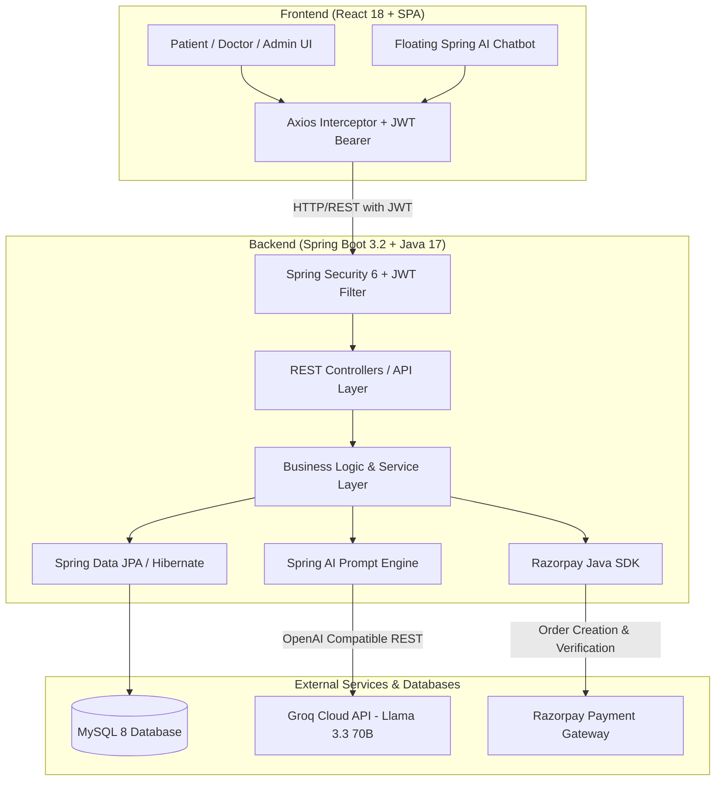

# 🩺 MyDoctor — Smart Healthcare Appointment & Clinical AI System

[](https://spring.io/projects/spring-boot)
[](https://openjdk.org/)
[](https://react.dev/)
[](https://www.mysql.com/)
[](https://spring.io/projects/spring-ai)
[](https://razorpay.com/)
[](https://jwt.io/)

**MyDoctor** is an enterprise-grade full-stack healthcare platform that bridges patients, medical specialists, and clinic administrators into a unified digital ecosystem. It features an intelligent **Spring AI clinical chatbot** powered by Groq Llama 3.3 for symptom triage and doctor discovery, end-to-end **appointment lifecycle scheduling**, **Razorpay payment gateway** integration, and a comprehensive **Admin governance console**.

---

## 📑 Table of Contents

- [Overview & Architecture](#-overview--architecture)
- [Key Features](#-key-features)
  - [Patient Experience](#1-patient-experience)
  - [Doctor Practice Portal](#2-doctor-practice-portal)
  - [Spring AI Assistant & Symptom Triage](#3-spring-ai-assistant--symptom-triage)
  - [Platform Administration](#4-platform-administration)
- [Tech Stack](#-tech-stack)
- [Project Directory Structure](#-project-directory-structure)
- [Prerequisites](#-prerequisites)
- [Step-by-Step Setup Guide](#-step-by-step-setup-guide)
  - [1. Database Configuration](#1-database-configuration)
  - [2. Backend Setup (Spring Boot)](#2-backend-setup-spring-boot)
  - [3. Frontend Setup (React)](#3-frontend-setup-react)
- [Default Credentials & Seeding](#-default-credentials--seeding)
- [API Reference](#-api-reference)
- [Environment Variables](#-environment-variables)
- [Troubleshooting & FAQ](#-troubleshooting--faq)
- [License](#-license)

---

## 🏛 Overview & Architecture

The application is structured into decoupled frontend and backend layers with persistent relational storage and AI inference integrations:



---

## ✨ Key Features

### 1. Patient Experience
- **Doctor Catalog & Exploration**: Search doctors by name, clinic location, and filter by clinical specialty (Cardiology, Dermatology, Neurology, Orthopedics, Pediatrics, General Medicine, etc.).
- **Slot Availability Calendar**: View real-time active slots published by verified doctors.
- **Secure Appointment Booking**: Choose consultation types (In-Person or Video Consultation) with automated slot reservation.
- **Integrated Payments**: Frictionless payment checkout with Razorpay with payment verification and digital audit trail.
- **Appointment History & Actions**: Filter by status (`PENDING`, `CONFIRMED`, `COMPLETED`, `CANCELLED`), track upcoming schedules, and cancel reservations.
- **Patient Health Profile**: Maintain emergency contacts, blood group, allergies, address, and medical notes.

### 2. Doctor Practice Portal
- **Clinical Profile Management**: Configure specialization, medical registration number, experience years, clinic address, and consultation fees.
- **Interactive Slot Manager**:
  - Add individual date & time slots.
  - **Bulk Slot Generator**: Automatically generate 15-, 30-, or 60-minute appointment slots across custom time ranges.
  - Block or delete unbooked slots with one click.
- **Patient Appointment Queue**: Real-time list of pending appointment requests with one-touch `Confirm`, `Reject`, or `Complete` workflows.
- **Practice Analytics**: Real-time count of total patients, pending requests, confirmed visits, and earnings overview.

### 3. Spring AI Assistant & Symptom Triage
- **Clinical Symptom Extraction**: Parses natural language symptom descriptions (e.g., chest discomfort, migraine, rash, joint pain, shortness of breath).
- **Automated Specialty Referral**: Maps symptoms to medical specialties and recommends matching verified practitioners in the database.
- **Context-Aware Schedule Prompts**: Alerts the patient if they have existing pending appointments when asking about booking or visits.
- **Hybrid AI Engine**:
  - Connects to **Groq Cloud** using Spring AI's OpenAI-compatible interface running `llama-3.3-70b-versatile`.
  - Built-in **expert clinical heuristic fallback** that continues to provide accurate doctor recommendations and guidance even during offline or rate-limited scenarios.
- **Dual UI Access**: Available as a dedicated **AI Health Assistant Page** and a persistent floating widget accessible on all patient screens.

### 4. Platform Administration
- **Executive Metrics Dashboard**: Aggregates total system users, verified doctor counts, patient volume, total bookings, and platform revenue.
- **User Lifecycle Governance**: View, search, edit, create, activate/deactivate, and delete patient/doctor accounts.
- **Doctor Verification Controls**: Review submitted doctor profiles and toggle formal system verification badges.
- **Appointment Moderation**: Filter system-wide appointments with administrative status overriding and cancellation abilities.
- **Financial Ledger**: Inspect payment transactions, Razorpay payment IDs, and audit records.

---

## 💻 Tech Stack

| Layer | Technologies |
|---|---|
| **Backend** | Java 17, Spring Boot 3.2.0, Spring Data JPA, Spring Security 6, Spring Validation, Lombok |
| **Artificial Intelligence** | Spring AI (`spring-ai-openai-spring-boot-starter`), Groq Cloud API (`llama-3.3-70b-versatile`) |
| **Security & Auth** | JSON Web Tokens (`jjwt 0.12.3`), BCrypt Password Encoding, Role-Based Access Control (`ROLE_PATIENT`, `ROLE_DOCTOR`, `ROLE_ADMIN`) |
| **Database** | MySQL 8.0+, Hibernate ORM |
| **Payments** | Razorpay Java SDK 1.4.6, Razorpay Checkout Modal |
| **Frontend** | React 18.2, React Router DOM v6, Axios, Framer Motion, Lucide React, React Hot Toast, Date-fns, React CountUp, React Tilt |
| **Styling** | Custom Responsive Modern Glassmorphic CSS Design System with CSS variables and subtle micro-animations |

---

## 📂 Project Directory Structure

```text
MyDoctor---Project-2-main/
├── README.md
├── .gitignore
├── mydoctor-backend/
│   ├── add_admin.sql                         # SQL utility script to create admin accounts
│   └── mydoctor/                             # Spring Boot Maven Project Root
│       ├── pom.xml                           # Dependencies & Spring AI configuration
│       └── src/
│           ├── main/
│           │   ├── java/com/mydoctor/
│           │   │   ├── MyDoctorApplication.java
│           │   │   ├── config/               # Security, Razorpay, and DataInitializer
│           │   │   ├── controller/           # REST endpoints (Auth, Doctor, Patient, Slot, Admin, Payment)
│           │   │   ├── dto/                  # Request / Response Transfer Objects
│           │   │   ├── entity/               # JPA Entities (User, DoctorProfile, PatientProfile, Appointment, TimeSlot, Payment)
│           │   │   ├── enums/                # Role, AppointmentStatus, SlotStatus, PaymentStatus
│           │   │   ├── exception/            # GlobalExceptionHandler & Custom Exceptions
│           │   │   ├── repository/           # Spring Data JPA Repositories
│           │   │   ├── security/             # JwtTokenProvider, JwtAuthFilter, UserDetailsService
│           │   │   ├── service/              # Service Interfaces & Implementations (ChatbotServiceImpl, etc.)
│           │   │   └── util/                 # Password utility & AddAdminUtil
│           │   └── resources/
│           │       └── application.properties # Server, DB, JWT, Razorpay & Spring AI configuration
│           └── test/
└── mydoctor-frontend/
    └── mydoctor-frontend/                    # React Single Page Application Root
        ├── package.json                      # React dependencies & scripts
        ├── public/
        └── src/
            ├── App.js                        # Top-level routing & ProtectedRoute guards
            ├── index.js
            ├── index.css                     # Global design system & theme tokens
            ├── components/
            │   ├── patient/PatientChatbot.js # Floating Spring AI Chatbot component
            │   └── shared/Navbar.js          # Responsive navigation bar
            ├── context/
            │   └── AuthContext.js            # Authentication state, login & logout handlers
            ├── pages/
            │   ├── LoginPage.js              # Split-screen role authentication
            │   ├── RegisterPage.js           # Multi-role registration (Patient & Doctor)
            │   ├── patient/                  # FindDoctors, MyAppointments, PatientDashboard, PatientProfile, PatientAssistantPage
            │   ├── doctor/                   # DoctorDashboard, DoctorAppointments, ManageSlots, DoctorProfile
            │   └── admin/                    # AdminDashboard, AdminDoctors, AdminUsers, AdminAppointments, AdminPayments
            └── services/
                └── api.js                    # Centralized Axios client & API endpoints
```

---

## ⚙️ Prerequisites

Before running the application, make sure you have the following installed:

1. **Java Development Kit (JDK)**: Version **17** or higher
   - Verify with: `java -version`
2. **Apache Maven**: Version **3.8+**
   - Verify with: `mvn -version`
3. **Node.js**: Version **18+** and **npm** Version **9+**
   - Verify with: `node -v` and `npm -v`
4. **MySQL Server**: Version **8.0+**
   - Verify with: `mysql --version`
5. *(Optional but Recommended)*:
   - **Groq API Key**: Obtain from [Groq Console](https://console.groq.com/) for Llama 3.3 AI Chatbot.
   - **Razorpay Test Keys**: Obtain `Key ID` and `Key Secret` from [Razorpay Dashboard](https://dashboard.razorpay.com/).

---

## 🚀 Step-by-Step Setup Guide

### 1. Database Configuration

Start your local MySQL service and create the application database:

```sql
CREATE DATABASE IF NOT EXISTS mydoctor_db CHARACTER SET utf8mb4 COLLATE utf8mb4_unicode_ci;
```

> **Note**: Spring Boot Hibernate is set to `spring.jpa.hibernate.ddl-auto=update`, so all tables, foreign keys, and indexes will be automatically generated upon initial backend startup.

---

### 2. Backend Setup (Spring Boot)

1. Open a terminal and navigate to the Spring Boot project folder:
   ```bash
   cd mydoctor-backend/mydoctor
   ```

2. Configure `src/main/resources/application.properties` or provide environment variables:
   ```properties
   # Server Port
   server.port=8080

   # MySQL Connection
   spring.datasource.url=jdbc:mysql://localhost:3306/mydoctor_db?createDatabaseIfNotExist=true&useSSL=false&allowPublicKeyRetrieval=true&serverTimezone=UTC
   spring.datasource.username=root
   spring.datasource.password=YOUR_MYSQL_PASSWORD

   # JWT Security Key (HS256 requires 256-bit string)
   app.jwt.secret=MyDoctorSuperSecretKeyForJWTSigningMustBe256BitsLongForHS256Algorithm
   app.jwt.expiration-ms=86400000

   # CORS Allowed Origins
   app.cors.allowed-origins=http://localhost:3000

   # Razorpay Gateway Test Credentials
   razorpay.key.id=YOUR_RAZORPAY_KEY_ID
   razorpay.key.secret=YOUR_RAZORPAY_KEY_SECRET

   # Spring AI with Groq (OpenAI-compatible endpoint)
   spring.ai.openai.base-url=https://api.groq.com/openai
   spring.ai.openai.api-key=YOUR_GROQ_API_KEY
   spring.ai.openai.chat.options.model=llama-3.3-70b-versatile
   ```

3. Build and launch the Spring Boot application:
   ```bash
   mvn clean spring-boot:run
   ```
   *The backend will boot up on `http://localhost:8080`.*

---

### 3. Frontend Setup (React)

1. Open a new terminal and navigate to the frontend app folder:
   ```bash
   cd mydoctor-frontend/mydoctor-frontend
   ```

2. Install dependencies:
   ```bash
   npm install
   ```

3. Start the React development server:
   ```bash
   npm start
   ```
   *The application will launch in your browser at `http://localhost:3000`.*

---

## 🔑 Default Credentials & Seeding

On initial backend startup, the `DataInitializer` class automatically creates the default platform administrator:

| Role | Email | Password | Access Path |
|---|---|---|---|
| **Administrator** | `admin@mydoctor.com` | `Admin@123` | `/login` ➔ `/admin` |

### Adding Custom Administrators
You can also manually provision administrators by executing the included SQL script:
```bash
mysql -u root -p mydoctor_db < mydoctor-backend/add_admin.sql
```

### Self-Registration (Doctors & Patients)
- Visit `http://localhost:3000/register`
- Select **Patient** to create a personal patient profile and immediately explore doctors and book appointments.
- Select **Doctor** to specify your specialty, medical license number, and consultation fee to open your doctor dashboard.

---

## 📡 API Reference

### 🔐 Authentication (`/api/auth`)
| Method | Endpoint | Description | Access |
|---|---|---|---|
| `POST` | `/api/auth/register` | Registers a new user (`PATIENT` or `DOCTOR`) | Public |
| `POST` | `/api/auth/login` | Authenticates credentials and returns JWT token + user payload | Public |

### 👨‍⚕️ Doctors (`/api/doctors` & `/api/doctor`)
| Method | Endpoint | Description | Access |
|---|---|---|---|
| `GET` | `/api/doctors/list` | List all verified and active doctors | Public |
| `GET` | `/api/doctors/search?keyword={kw}` | Search doctors by name or clinic location | Public |
| `GET` | `/api/doctors/specialization?name={name}` | Filter doctors by medical specialization | Public |
| `GET` | `/api/doctor/profile` | Retrieve logged-in doctor's profile | Doctor |
| `PUT` | `/api/doctor/profile` | Update profile, bio, fees, and specialization | Doctor |
| `GET` | `/api/doctor/dashboard` | Doctor dashboard metrics & upcoming schedule | Doctor |

### ⏰ Time Slots (`/api/slots`)
| Method | Endpoint | Description | Access |
|---|---|---|---|
| `GET` | `/api/slots/available?doctorId={id}&date={date}` | Retrieve available slots for a doctor on a date | Authenticated |
| `GET` | `/api/slots/my?date={date}` | Doctor retrieves their own scheduled slots | Doctor |
| `POST` | `/api/slots` | Create a single appointment slot | Doctor |
| `POST` | `/api/slots/bulk` | Bulk generate slots across start & end times | Doctor |
| `DELETE` | `/api/slots/{id}` | Delete a slot | Doctor |
| `PATCH` | `/api/slots/{id}/block` | Toggle slot block status | Doctor |

### 📅 Appointments (`/api/appointments`)
| Method | Endpoint | Description | Access |
|---|---|---|---|
| `POST` | `/api/appointments/book` | Book an appointment slot | Patient |
| `GET` | `/api/appointments/my/patient` | Get all patient appointments | Patient |
| `PATCH` | `/api/appointments/{id}/cancel` | Cancel an appointment | Patient / Doctor / Admin |
| `GET` | `/api/appointments/my/doctor` | Get all appointments for logged-in doctor | Doctor |
| `GET` | `/api/appointments/my/doctor/pending` | Get doctor's pending appointment queue | Doctor |
| `PATCH` | `/api/appointments/{id}/confirm` | Accept & confirm an appointment request | Doctor |
| `PATCH` | `/api/appointments/{id}/reject` | Reject an appointment with reason notes | Doctor |
| `PATCH` | `/api/appointments/{id}/complete` | Mark appointment consultation complete | Doctor |

### 🤖 Patient AI Assistant (`/api/patient`)
| Method | Endpoint | Description | Access |
|---|---|---|---|
| `POST` | `/api/patient/chatbot/message` | Process message with Spring AI triage engine | Patient |
| `GET` | `/api/patient/profile` | Get patient profile details | Patient |
| `PUT` | `/api/patient/profile` | Update patient profile details | Patient |
| `GET` | `/api/patient/dashboard` | Patient metrics & pending appointments | Patient |

### 💳 Payments (`/api/payments`)
| Method | Endpoint | Description | Access |
|---|---|---|---|
| `POST` | `/api/payments/create-order` | Create a Razorpay order for an appointment | Patient |
| `POST` | `/api/payments/verify` | Verify Razorpay payment signature & update appointment | Patient |

### 🛡️ Admin Management (`/api/admin`)
| Method | Endpoint | Description | Access |
|---|---|---|---|
| `GET` | `/api/admin/stats` | Platform metrics (users, doctors, revenue, appointments) | Admin |
| `GET` | `/api/admin/users` | List and search all users with role filtering | Admin |
| `POST` | `/api/admin/users` | Create user directly from admin console | Admin |
| `PUT` | `/api/admin/users/{id}` | Update user details | Admin |
| `PATCH` | `/api/admin/users/{id}/toggle-status` | Enable or disable user account | Admin |
| `DELETE` | `/api/admin/users/{id}` | Remove user | Admin |
| `GET` | `/api/admin/doctors` | Doctor management and verification queue | Admin |
| `PATCH` | `/api/admin/doctors/{id}/verification` | Set doctor verification status | Admin |
| `GET` | `/api/admin/appointments` | System-wide appointment records | Admin |
| `PATCH` | `/api/admin/appointments/{id}/status` | Admin status override | Admin |
| `GET` | `/api/admin/payments` | Financial transactions audit | Admin |

---

## 🌐 Environment Variables

You can supply these variables as system environment variables or inside your `.env` / `application.properties`:

| Variable | Description | Default Value |
|---|---|---|
| `DB_URL` | JDBC Connection String | `jdbc:mysql://localhost:3306/mydoctor_db?...` |
| `DB_USERNAME` | MySQL Database Username | `root` |
| `DB_PASSWORD` | MySQL Database Password | *(empty / your password)* |
| `JWT_SECRET` | 256-bit Secret Key for signing JWT tokens | Preconfigured 256-bit string |
| `CORS_ORIGINS` | Allowed origins for cross-origin requests | `http://localhost:3000` |
| `RAZORPAY_KEY_ID` | Razorpay API Key ID | `rzp_test_...` |
| `RAZORPAY_KEY_SECRET` | Razorpay API Key Secret | *(Your Razorpay Secret)* |
| `AI_BASE_URL` | OpenAI-compatible API base URL | `https://api.groq.com/openai` |
| `AI_API_KEY` | API key for AI chat client | *(Your Groq API key)* |
| `REACT_APP_API_URL` | Frontend API backend base URL | `""` *(uses React dev proxy)* |

---

## ❓ Troubleshooting & FAQ

<details>
<summary><b>1. MySQL Connection Refused / Access Denied</b></summary>

- Verify that your MySQL server is running:
  - Windows: Check `services.msc` for `MySQL80` service.
  - Linux/macOS: `sudo systemctl status mysql` or `brew services list`.
- Verify credentials in `application.properties`: ensure `spring.datasource.password` matches your local MySQL `root` user password.
</details>

<details>
<summary><b>2. Chatbot fallback works, but Groq AI is not responding</b></summary>

- Check that `AI_API_KEY` in `application.properties` is set to an active Groq Cloud API key.
- The chatbot has a built-in safety net: if the Groq API key is expired or rate-limited, it automatically falls back to the clinical heuristic engine without throwing 500 errors to the patient.
</details>

<details>
<summary><b>3. React cannot reach backend (CORS or Network Error)</b></summary>

- By default, `mydoctor-frontend/mydoctor-frontend/package.json` includes `"proxy": "http://localhost:8080"`.
- Ensure the Spring Boot backend is actively running on port `8080` before starting the frontend.
</details>

<details>
<summary><b>4. Port 8080 or Port 3000 is already in use</b></summary>

- **Backend (Port 8080)**: Change `server.port=8081` in `application.properties` and update `"proxy"` in `package.json` to match.
- **Frontend (Port 3000)**: React will prompt you: *"Would you like to run the app on another port instead? (Y/n)"* — press `Y` to start on port `3001`.
</details>

---

## 📄 License

This project is licensed under the [MIT License](LICENSE) — feel free to adapt, extend, and use it for your academic, personal, or healthcare innovation projects.

---

<p align="center">
  <b>Built with ❤️ using Spring Boot & React</b><br>
  <i>Empowering modern digital healthcare solutions.</i>
</p>
